# 架构总览

这一页是整套设计的"地图"：分层、依赖方向、运行时数据流、以及每个决策背后的取舍。
如果你只读一页文档，读这一页。

## 1. 问题定义

同一套业务能力要服务三条产品线：

| 产品线 | UI 库 | 平台 | 特征 |
|---|---|---|---|
| 后台管理 | element-plus | desktop | 表格密集、表单密集 |
| 移动端 H5 | vant4 | mobile | 卡片、下拉加载、picker |
| 新业务线 | naive-ui | desktop | provider 型主题、虚拟滚动 |

三种错误的解法：

1. **在业务组件里写三套分支** → 得到一个 200 个 props 的万能组件，三边都不像。
2. **只锁定一个 UI 库** → 另外两条产品线无法复用。
3. **薄薄包一层**（`MyButton` 包 `el-button`）→ 多了一层组件，没有任何抽象收益。

FBK 的解法：**只归一化原语与交互语义，不归一化业务语义**。

## 2. 分层架构

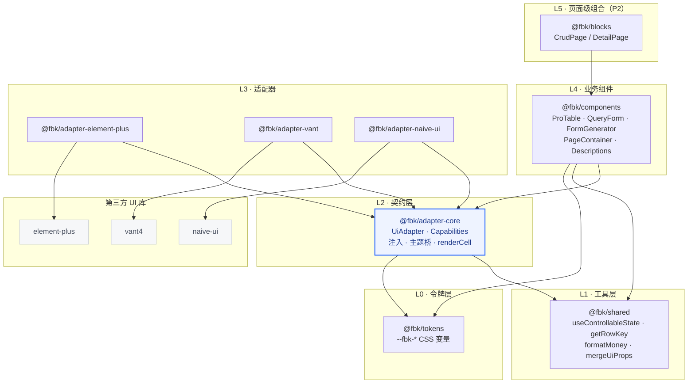

**关键点**：UI 库只出现在 L3。L4 的业务组件连 `import type` 都不允许碰 UI 库。

## 3. 依赖方向

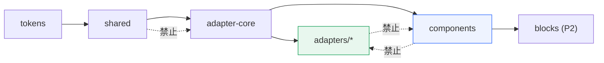

规则表：

| # | 规则 | 违反后果 |
|---|---|---|
| 1 | 只有 `packages/adapters/**` 可 import UI 库，**含 `import type`** | UI 库升级即 breaking change |
| 2 | `components` 只能依赖 `adapter-core` / `shared` / `tokens` | 业务组件绑定单一 UI 库 |
| 3 | `adapters` 禁止反向依赖 `components` | 循环依赖 + 打包爆炸 |
| 4 | 公开 `.d.ts` 不含 UI 库类型 | 下游被迫安装 UI 库类型 |
| 5 | 组件 CSS 只用 `--fbk-*` 与 `.fbk-*` | 小版本升级样式碎裂 |
| 6 | 组件不依赖 vue-router / axios / dayjs | 库无法在异构应用复用 |
| 7 | 禁止循环依赖 | tree-shaking 失效 |

规则 1 是整套架构的命门，因此用两道闸：

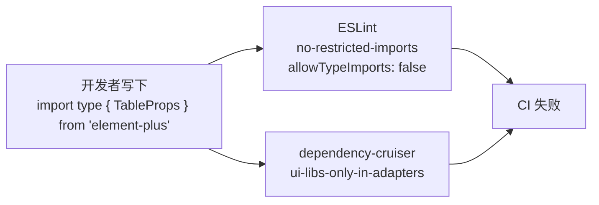

> 为什么必须两道：ESLint 只看"文件里写了什么 import"，dependency-cruiser 看的是**解析后的真实依赖图**，
> 能抓住路径别名、re-export 链、循环依赖。

## 4. 运行时：注入与解析

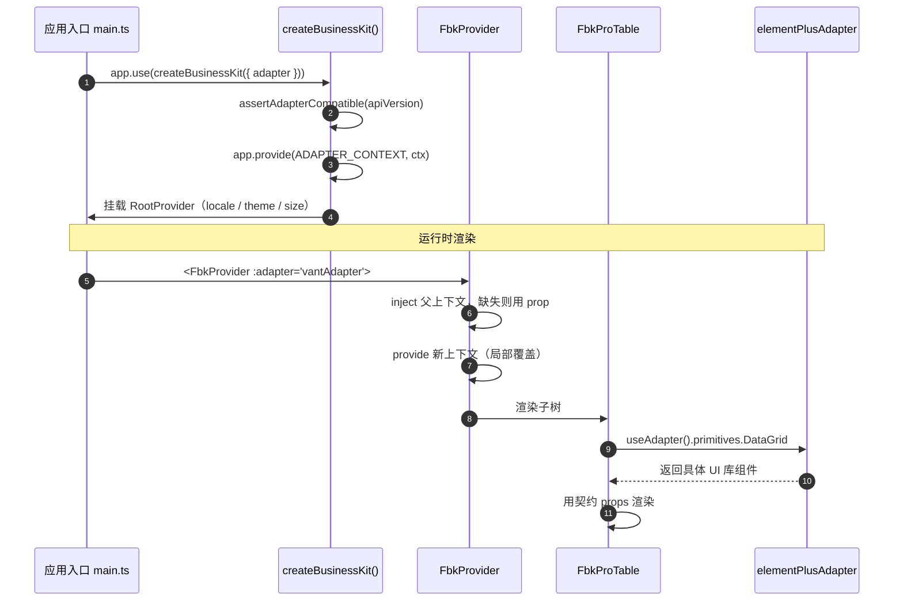

注入键：

```ts
export const ADAPTER_CONTEXT = Symbol.for('fbk.adapter.context')
```

用 `Symbol.for` 而不是 `Symbol()`：pnpm 严格结构下通常只有一份 `adapter-core`，
但微前端、`npm link`、多版本共存都可能产生两份。普通 `Symbol()` 的 key 不相等，`inject` 直接失败。

**不做自动探测**：`useAdapter()` 找不到适配器时直接抛错并附文档链接。
自动探测会破坏"只装所需适配器"的承诺，且 SSR / 微前端下行为不可预测。

## 5. 契约结构

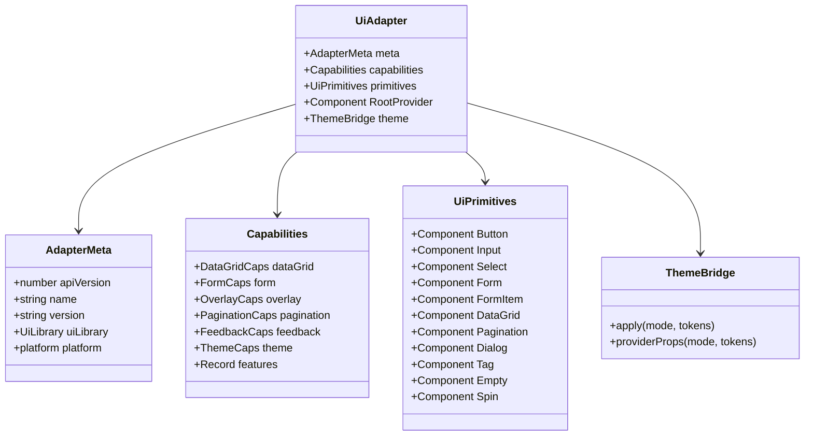

四条设计原则：

1. **数据驱动优先于插槽组合**。`Select` 接收 `options` 数组，而不是让业务侧拼 `<el-option>` / `<van-picker-column>`。
2. **能力声明优先于功能对齐**。声明 `capabilities`，业务组件按能力降级。
3. **逃生舱优先于穷举映射**。映射不到的原生 props 走 `uiProps`（类型是 `Record<string, any>`）。
4. **适配器拥有 DOM 与交互，业务组件拥有布局与状态**。

## 6. 数据流：ProTable 一次请求

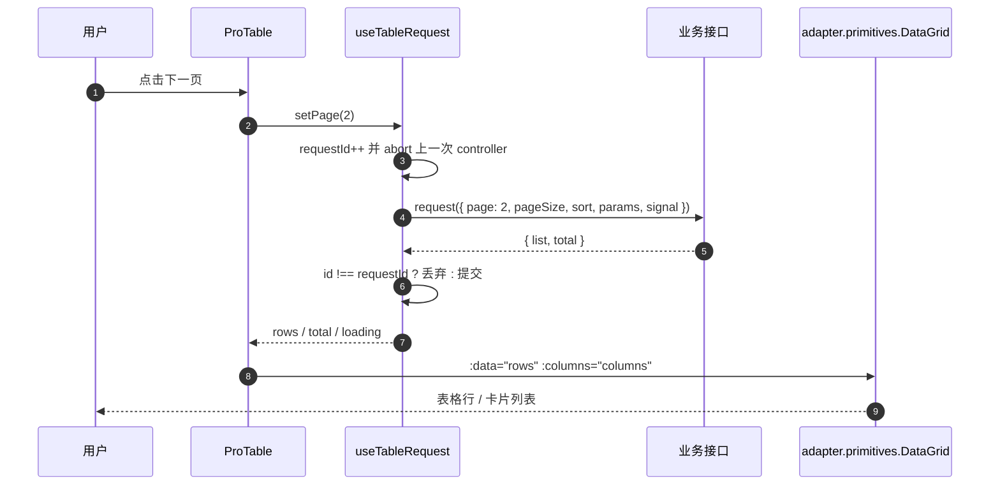

竞态处理是双保险：

```ts
let requestId = 0
let controller: AbortController | null = null

async function run() {
  const id = ++requestId
  controller?.abort()
  controller = new AbortController()
  const result = await request({ signal: controller.signal })
  if (id !== requestId) return // 过期响应直接丢弃
  rows.value = result.list
}
```

- `AbortController`：取消在途请求，省流量。
- `requestId`：即使请求库不响应 abort，也不会用旧数据覆盖新数据。
- 组件卸载时 abort。

## 7. DataGrid：表现层无关

这是整套架构最有价值、也最容易做错的部分。**不要把三库 Table 统一成一套 column props**。

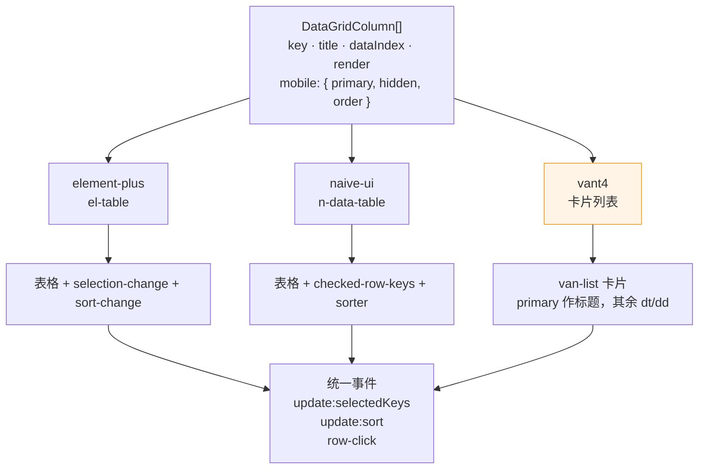

列裁剪由 `column.mobile` 控制，而不是在业务组件里写 `isMobile` 分支：

```ts
{ key: 'orderNo', title: '订单号', dataIndex: 'orderNo', mobile: { primary: true } }
{ key: 'createdAt', title: '创建时间', dataIndex: 'createdAt', mobile: { hidden: true } }
```

业务语义（money / date / enum / tag）由**业务组件**解析成 `column.render`，适配器不需要知道什么是金额。

## 8. 主题：两种桥

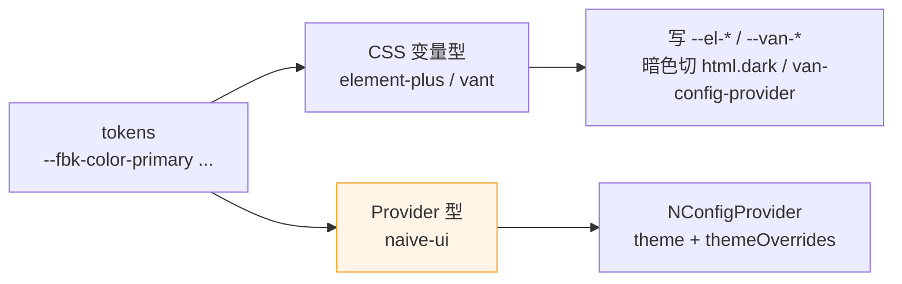

| 适配器 | 机制 | 暗色 |
|---|---|---|
| element-plus | 写 `--el-*` | `html.dark` + `dark.css` |
| vant | 写 `--van-*` | `van-config-provider theme="dark"` |
| naive-ui | `NConfigProvider` | `providerProps()` 返回 `{ theme: darkTheme }` |

> naive-ui 没有可覆盖的 CSS 变量体系。只 `apply()` 不包 `<FbkProvider>` 时暗色不会生效——
> 这是文档必须写死的坑。

## 9. 构建与产物

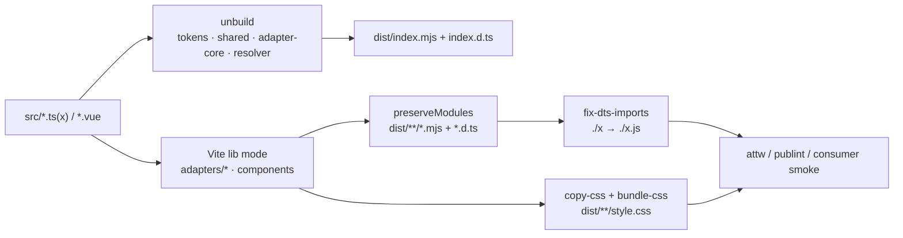

几个非显然的取舍：

- **ESM-only**：双格式需要 `.d.cts`、双包风险、attw 复杂度。企业内 Vite / Webpack5 消费 ESM 无障碍。
- **`preserveModules`**：产物文件多，但跨入口共享代码只保留一份，堆栈直接对应源码。
- **样式独立文件，禁止 SFC `<style>`**：Vite lib mode 多入口 + preserveModules 下 CSS 抽取路径不稳定。
- **d.ts 说明符改写**：`vite-plugin-dts` 产出无扩展名的相对说明符，node16/nodenext 消费者会解析失败。
  构建后统一补 `.js` / `/index.js`。
- **`sideEffects: ["**/*.css"]`**：JS 保持可摇。

## 10. 质量体系

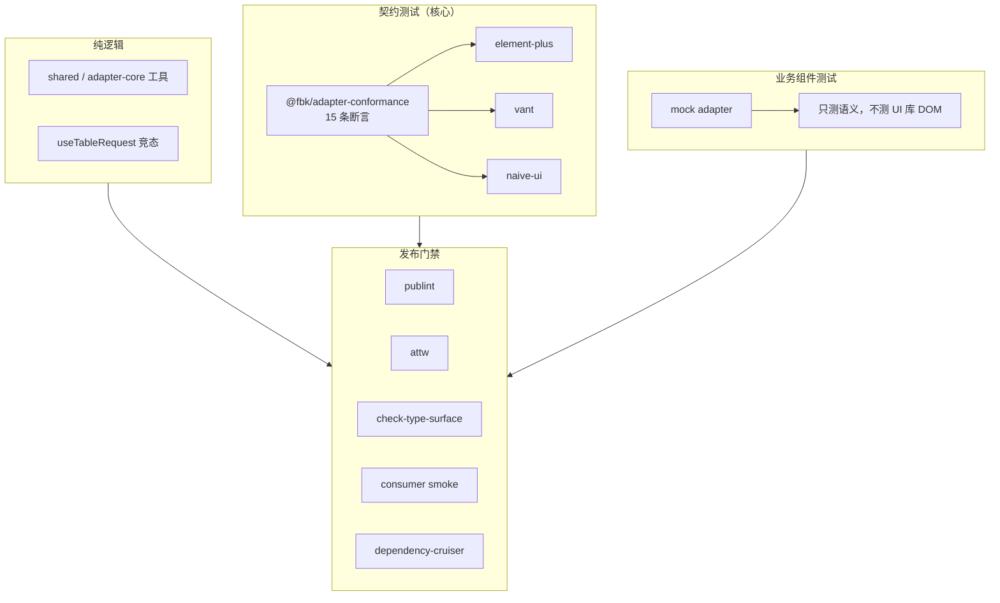

三个适配器跑**同一套** 15 条断言，这是"换适配器只改注入"这句话唯一可信的证据。

## 11. 一次适配器切换发生了什么

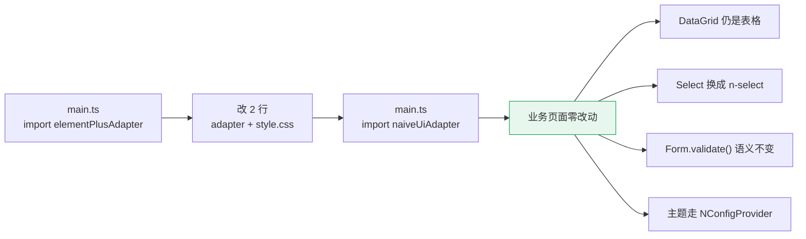

## 12. 反模式清单

评审时逐条对照：

| # | 反模式 | 后果 |
|---|---|---|
| 1 | 万能组件抽象：200 个 props 覆盖三库能力 | 三边都不像，用户绕回原生库 |
| 2 | 公开 API 泄漏 UI 库类型 | UI 库升级即 breaking change |
| 3 | 适配层反向依赖业务组件 | 循环依赖 + 打包爆炸 |
| 4 | 自动探测 UI 库 | 破坏"只装所需适配器"，SSR 不可控 |
| 5 | 注入键用普通 `Symbol()` | 多份 core 时 inject 失效 |
| 6 | 适配器版本漂移 | core 与 adapter 错配，运行时崩 |
| 7 | 把移动端当媒体查询 | 真正的差异是交互模型，不是宽度 |
| 8 | 业务 CSS 穿透 UI 库内部类 | 小版本升级即碎 |
| 9 | 文档示例不参与编译 | 半年后全错 |
| 10 | 只在一个适配器上测试 | 上线才发现 vant 没有 Table |
| 11 | 受控/非受控语义模糊 | 数据流不可预测 |
| 12 | 请求竞态 | 快速翻页时旧响应覆盖新数据 |
| 13 | 组件内建请求库 / 路由依赖 | 库无法在异构应用复用 |
| 14 | 副作用入口：`index.ts` import CSS | tree-shaking 失效、SSR 报错 |
| 15 | 打包 Vue | 双 Vue 导致 provide/inject 失效 |
| 16 | 发布漏文件 | 装上就报错 |
| 17 | 把 `uiProps` 当主 API | 用户学会的是 element-plus 而不是你的库 |
| 18 | 过度追求三库像素一致 | 维护成本爆炸，收益为零 |
| 19 | 无 API 快照 | prop 悄悄改名，下游运行时才炸 |
| 20 | 地基没稳就做 blocks | 页面级组合会倒逼业务组件 API 过早定型 |

## 13. 演进路线

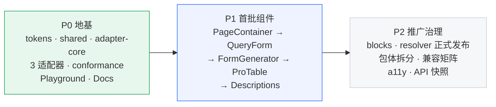

当前状态：契约已到 `ADAPTER_API_VERSION = 3`（版本 2 补了 DatePicker / Radio 原语与命令式
`feedback`，版本 3 补了 Drawer 原语），三个第一方适配器均已跟随。
